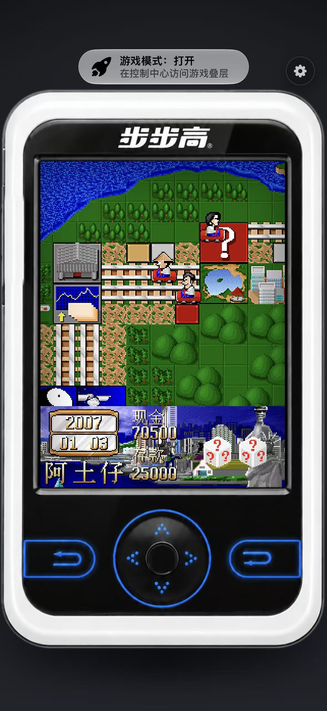

# bbasic-ios

步步高 9688（BBK 外语通）的虚拟机 iOS 移植 —— 用 SwiftUI 原生复刻了整台机器：
机壳、按键、Logo 全部来自真机照片，屏幕上跑的是真实的 `.bin` 字节码。

> 📖 **详细文档见 [BB9688/README.md](BB9688/README.md)** —— 架构、按键映射、踩坑记录、修复过程全在里面。

## 运行截图

iPhone 真机运行效果 —— 照片机壳 + LCD + 按键辉光，屏幕上跑的是原版 `rich.bin` 字节码（大富翁2）：



## 这是什么

9688 是一台按键式电子词典，上面跑的是一套自有字节码虚拟机（BBVM）。本项目把这套 VM
完整移植到了 iOS：

- **BBVM 指令集**：LD / PUSH / POP / IN / OUT / JMP / CALL / RET / CMP / EXIT 等，
  指令长度与寻址编码逐条对齐原 C++ 实现
- **端口 0–80**：字符串池、文件 IO、9 张画布、图片资源（.LIB 解码）、画笔图元、按键
- **整机界面**：照片机壳 + LCD + 按键辉光 + 摇杆热区，几何全部实测百分比定位
- **画面清晰度**：按物理像素 1:1 出图，最近邻/面积平均缩放，杜绝二次缩放发糊
- **内置程序**：大富翁 / Flappy Bird / MAN 演示，已逐像素比对过 PC 版截图
- **程序导入**：支持「文件」App 往 `Documents/Programs/` 丢目录即可运行

## 快速开始

两条构建路线，同一批源码：

| 环境 | 命令 | 说明 |
|---|---|---|
| WSL / Linux | `./build.sh xtool` | 用 [xtool](https://xtool.sh) 交叉编译，不需要 Mac |
| macOS | `./build.sh run` | 用 Xcode + 模拟器 |

或者直接 `open BB9688/BB9688.xcodeproj`（Xcode 15+，iOS 16+）。

## 仓库结构

```
BB9688/          ← iOS App 本体（本仓库唯一入库的工程）
├─ BB9688/       源码：Core/（VM，纯逻辑可单独编译）、App/、Device/、Screen/、Launcher/
├─ Resources/    机壳图、辉光层、内置程序（.bin + .LIB）
└─ ...           构建脚本、xtool 配置
```

其余逆向分析用的资料（原机资源、反汇编工具、原型脚本）不在仓库内。

## 已知限制

- 只跑 `.bin`，不带编译器；横屏未适配；无状态保存（切后台程序会重跑）
- 大富翁的文字是 `RICH.LIB` 里的位图，不走字体渲染

完整说明与开发记录 → **[BB9688/README.md](BB9688/README.md)**
